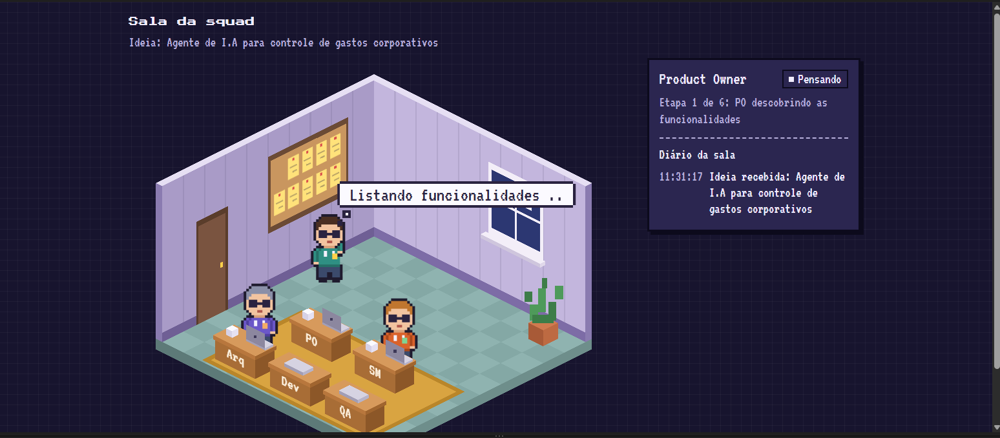
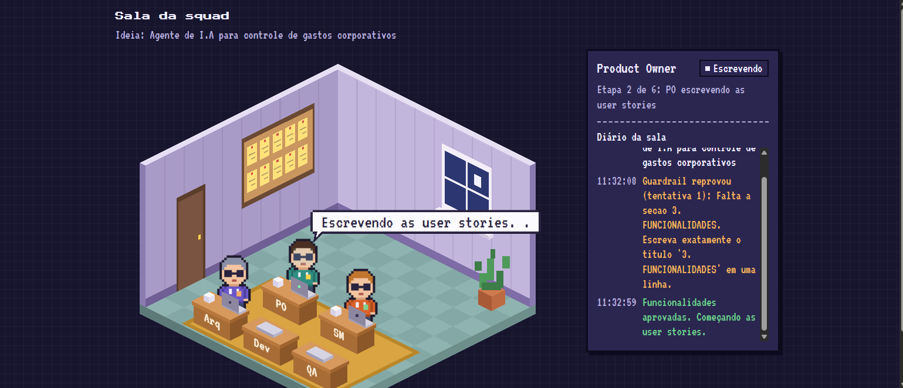
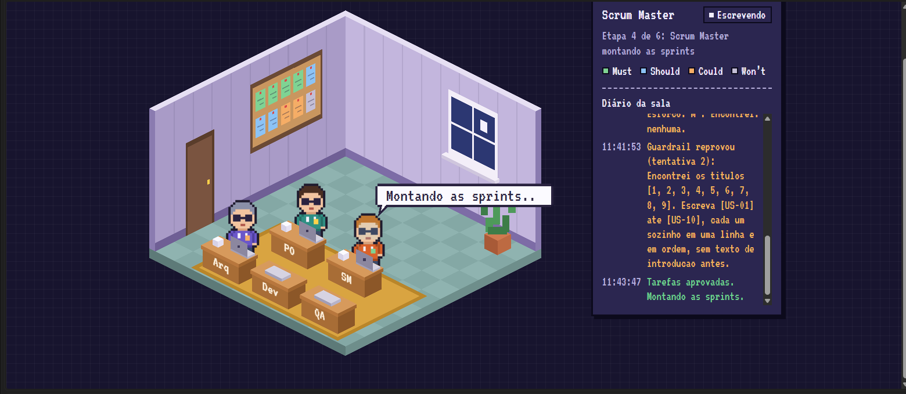
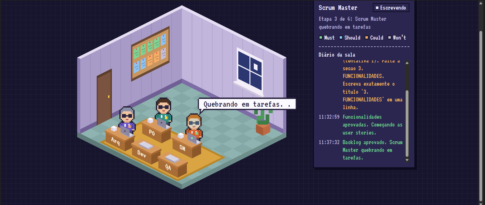
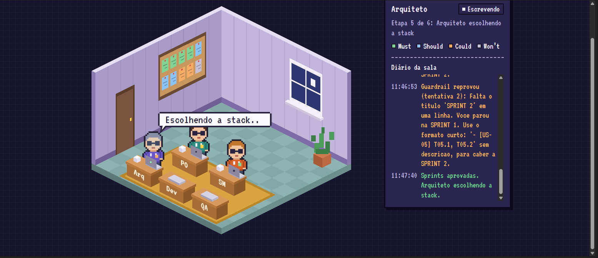
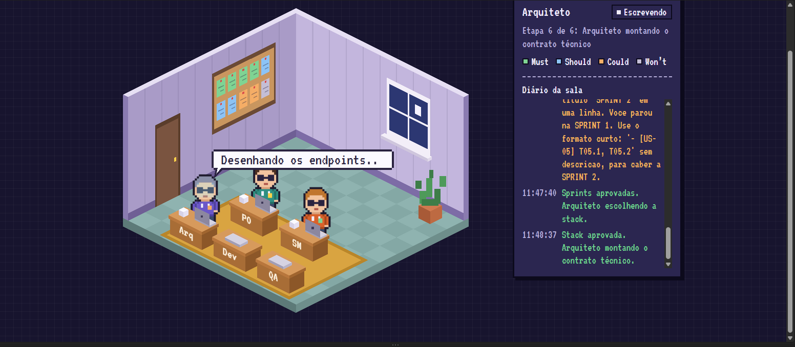
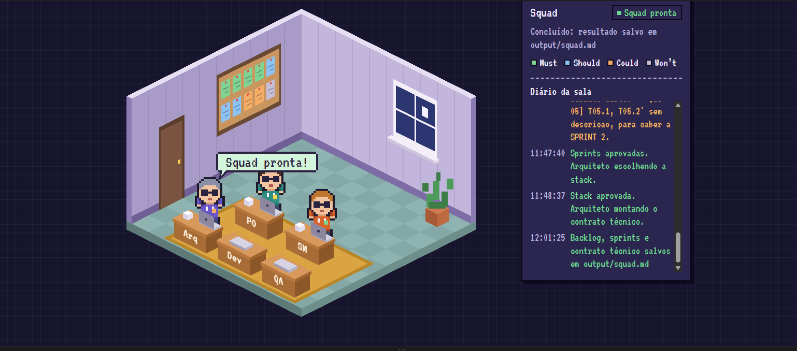

# agentic-squad

MultiAgent squad que simula um time Scrum completo: PO, Scrum Master, Dev, QA e Arquiteto.

Feito com CrewAI + llama3.2 3B rodando local no Ollama, com prompt chaining e guardrails que corrigem o modelo automaticamente.

## Como funciona hoje

Ideia -> PO -> Scrum Master -> Arquiteto -> squad.md

1. **PO:** recebe a ideia, gera 6 funcionalidades, 10 user stories com MoSCoW e criterios de aceite.
2. **Scrum Master:** quebra as 9 historias MUST/SHOULD/COULD em 18 tarefas tecnicas (P/M/G) e monta o plano de 2 sprints + Definicao de Pronto + Impedimentos.
3. **Arquiteto:** escolhe a stack e monta o contrato tecnico (endpoints da API).
4. **Guardrails:** se o modelo errar o formato, fugir do produto ou repetir tarefa, ele e reprovado e tenta de novo sozinho (ate 4 tentativas). O `squad.md` so e gerado quando passa em tudo.

## Processo passo a passo

Cada print e uma etapa do fluxo, na ordem em que acontece. O painel lateral mostra o agente atual, a etapa (X de 6) e o "Diario da sala" com os avisos dos guardrails.

Exemplo usado nos prints: **Agente de I.A para controle de gastos corporativos**.

### Etapa 1 de 6 - PO descobrindo as funcionalidades
`screenshots/etapa1_po.png`

### Etapa 2 de 6 - PO escrevendo as user stories
`screenshots/etapa2_po.png`

O guardrail reprovou a primeira tentativa (faltava o titulo `3. FUNCIONALIDADES`) e o PO corrigiu sozinho.

### Etapa 3 de 6 - Scrum Master quebrando em tarefas
`screenshots/etapa3_sm.png`

Backlog aprovado, as historias viram tarefas tecnicas.

### Etapa 4 de 6 - Scrum Master montando as sprints
`screenshots/etapa4_sm.png`

Tarefas aprovadas apos nova tentativa do guardrail (os titulos das historias estavam fora do formato `[US-01]` a `[US-10]`).

### Etapa 5 de 6 - Arquiteto escolhendo a stack
`screenshots/etapa5_arq.png`

Sprints aprovadas depois que o guardrail exigiu o titulo `SPRINT 2` e o formato curto das tarefas.

### Etapa 6 de 6 - Arquiteto montando o contrato tecnico
`screenshots/etapa6_arq.png`

Stack aprovada, o Arquiteto desenha os endpoints da API.

### Finalizado - Squad pronta
`screenshots/finalizado.png`

Backlog, sprints e contrato tecnico passaram em todos os guardrails e foram salvos em `output/squad.md`.

## Como rodar

    pip install -r requirements.txt
    python main.py

Digite a ideia quando pedir. Exemplo:

    Clone do IFOOD para delivery de comida

No final, abre o `squad.md` gerado.

## Exemplo de saida - squad.md

    # Squad - Clone do IFOOD

    ## Product Backlog
    [US-01] Como cliente, quero ver a lista de opcoes de entrega...

    ## Tarefas
    [US-01]
    - T01.1 | Criar tela de lista de opcoes | Esforco: P

    ## SPRINT 1
    Objetivo: ...
    - [US-01] T01.1, T01.2

    ## SPRINT 2
    ...

## Estrutura do projeto

    .
    ├── main.py
    ├── guardrails.py
    ├── requirements.txt
    ├── squad.md
    ├── screenshots/
    │   ├── etapa1_po.png
    │   ├── etapa2_po.png
    │   ├── etapa3_sm.png
    │   ├── etapa4_sm.png
    │   ├── etapa5_arq.png
    │   ├── etapa6_arq.png
    │   └── finalizado.png
    └── agents/
        ├── po_agent.py
        └── scrum_agent.py

## Roadmap

- [x] Checkpoint 1: PO + Scrum Master
- [x] Checkpoint 2: Arquiteto - decide a stack e o contrato da API
- [ ] Checkpoint 3: Dev Front - gera projeto/index.html, style.css, app.js
- [ ] Checkpoint 4: Dev Back - gera backend/app.py com API Flask
- [ ] Checkpoint 5: QA - valida o codigo gerado e o squad.md

## Por que llama3.2 3B?

Porque ele e pequeno e roda local, mas se perde em saidas longas. Por isso o projeto usa:

- **Prompt Chaining:** PO em 2 etapas, Scrum em 2 etapas, Arquiteto em 2 etapas, nunca tudo de uma vez.
- **Regras de formato fixas:** o modelo so copia o formato, nao inventa.
- **Guardrails em codigo:** regex + validacao em Python, nao depende do modelo se auto-corrigir.

## Requisitos

- Python 3.10+
- Ollama com llama3.2 instalado: ollama pull llama3.2
